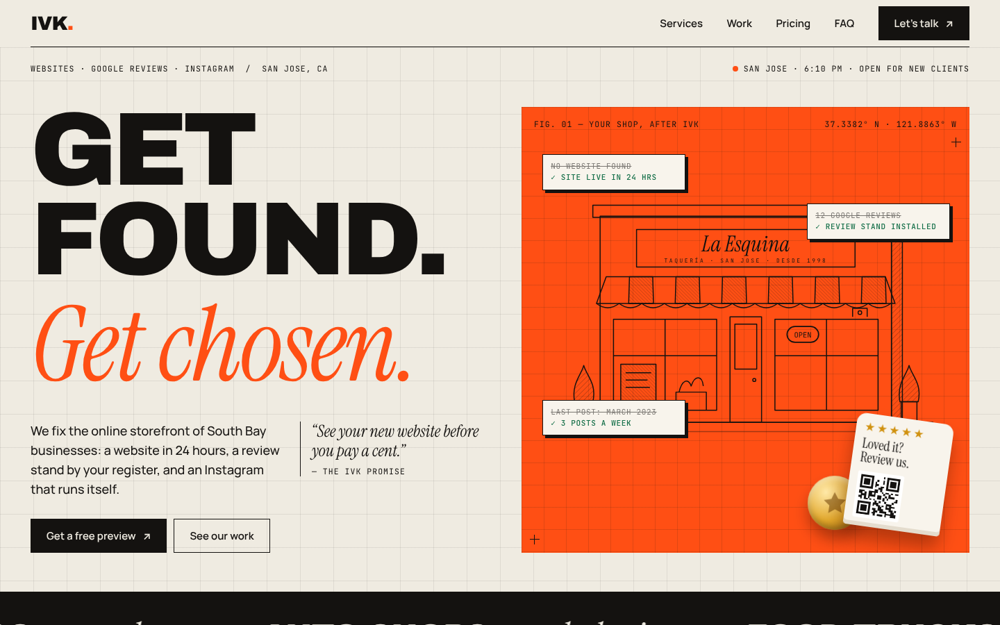
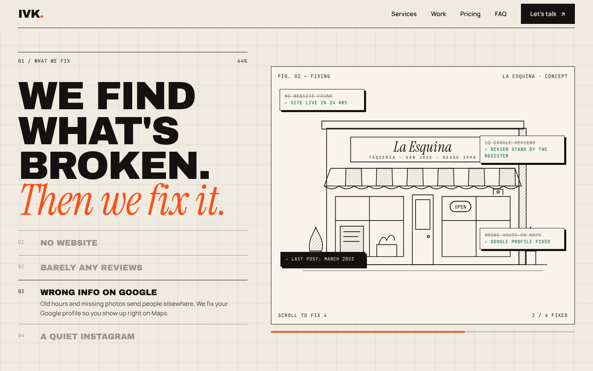
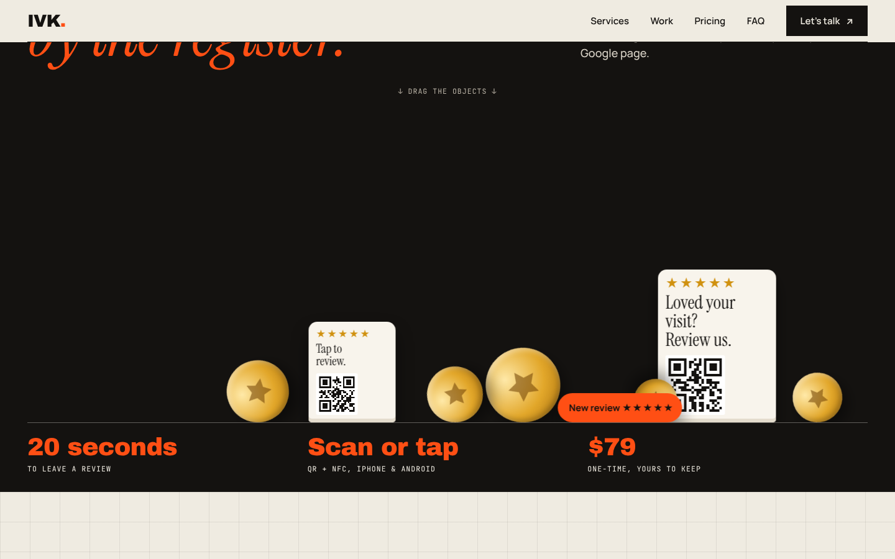
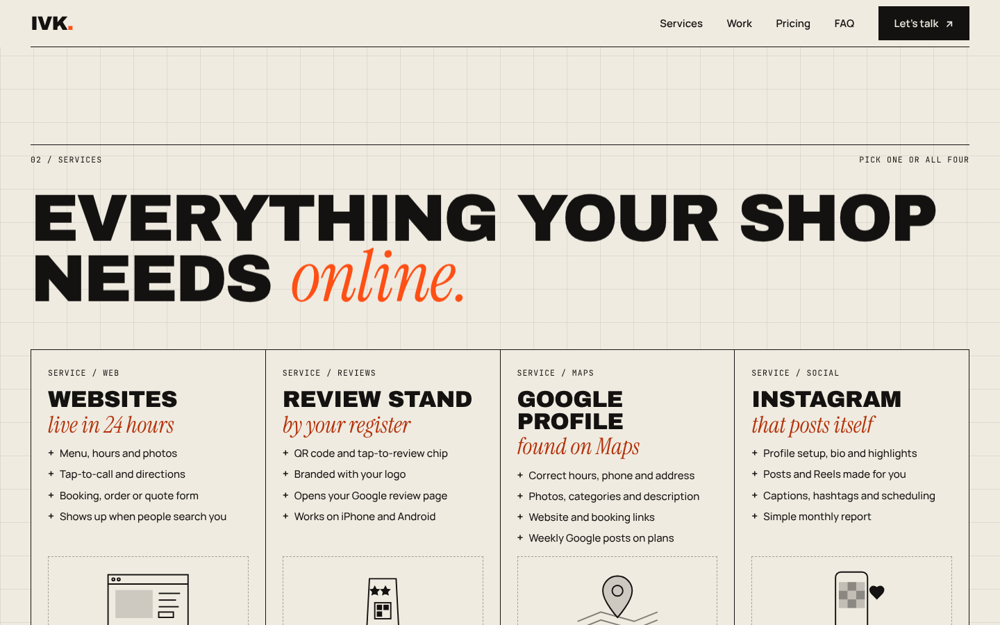
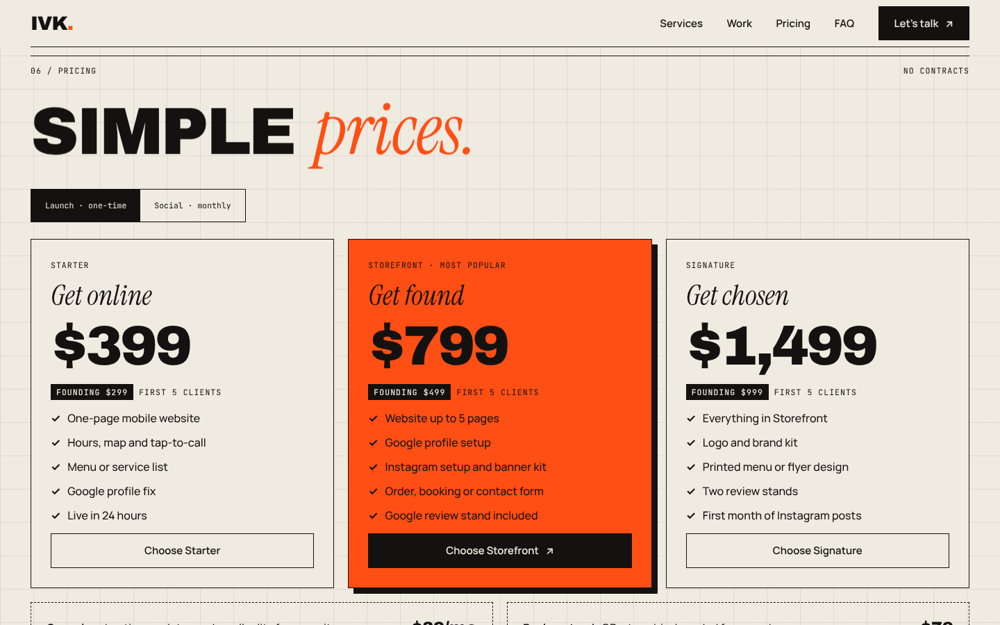
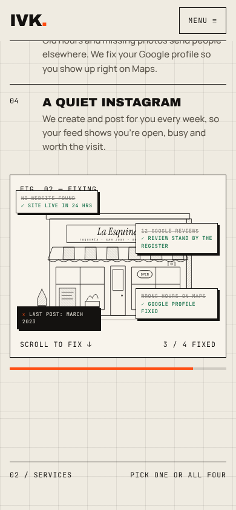

# IVK Media: Agency Website

**Live site:** [ivkmedia.com](https://ivkmedia.com)

A marketing website for **IVK Media**, a San Jose studio that builds websites, Google review stands and Instagram content for local businesses. Built as a single, dependency-free HTML file with plain CSS and vanilla JavaScript, with no frameworks.



## Highlights

- **Scroll-driven storytelling.** A pinned, hand-drawn SVG storefront whose problems ("No website", "12 reviews") get fixed one by one as you scroll, synced to a step list and progress bar.
- **Custom 2D physics.** Review stands and gold coins drop in when the section enters view. Visitors can grab and throw them. Includes gravity, bounce, circle collision, pointer drag with fling velocity, and a sleep state when everything comes to rest.
- **Blueprint design system.** A 48px grid, crosshair marks, figure labels and a three-font type system (Archivo Black, Instrument Serif, JetBrains Mono), all driven by CSS custom properties.
- **Live San Jose clock**, using `Intl.DateTimeFormat` with the America/Los_Angeles time zone.
- **Hover-follow previews** on the work list, **accessible pricing tabs** with arrow-key support, and **copy-to-clipboard** contact buttons with a fallback.

| Scroll story | Physics section |
|---|---|
|  |  |

| Services | Pricing |
|---|---|
|  |  |

## Mobile

<p>
  
  
</p>

Fully responsive from about 360px up, with a full-screen mobile menu, a stacked scroll story and touch-friendly physics.

## Performance and accessibility

- **No frameworks or build step.** One HTML file of about 60 KB, plus Google Fonts.
- **Holds 60 fps while scrolling.** Scroll work is batched with `requestAnimationFrame`, the DOM only updates when the state changes, animations are transform-only, and the physics loop sleeps when idle.
- **Respects `prefers-reduced-motion`.** All animation is disabled for people who turn it off.
- **Semantic landmarks, a skip link and visible focus states**, plus keyboard-operable tabs, menu and FAQ, and ARIA labels on illustrations.
- **Readable contrast:** color pairs were chosen to meet WCAG AA.

## Tech

`HTML` · `CSS` (custom properties, grid, sticky positioning, `clamp()` type scale) · `JavaScript` (vanilla, IntersectionObserver, Pointer Events) · `SVG` · Hosted on **Netlify** with a custom domain and HTTPS.

## Run locally

```bash
git clone https://github.com/VishalkiranRaichur/ivk-media-website.git
cd ivk-media-website
open index.html          # or: python3 -m http.server
```

## Credits

Created by **Vishalkiran Raichur** for IVK Media, San Jose, CA, with design and development help from Claude (Anthropic).
The "La Esquina" taqueria and other businesses shown on the site are fictional concept projects.
